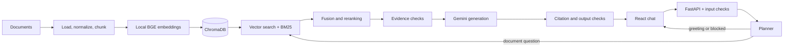

# Atlas — Technical Document RAG Assistant

Atlas is a local-first prototype for asking questions about technical documents. It extracts and indexes PDF, TXT, HTML, DOCX, and PPTX content, searches for evidence, and uses Gemini to draft an answer with source references. It is an MVP, not a production enterprise security system.

## Features and architecture

- File-type-specific loaders preserve document names and page or slide metadata.
- Local `BAAI/bge-small-en-v1.5` embeddings, ChromaDB semantic search, BM25 keyword candidates, reciprocal-rank fusion, and lexical/vector reranking.
- Input and evidence checks, citation assembly from retrieved chunks, and abstention when checks fail.
- React chat, source excerpts, document status, evaluation status, single-account login, and an in-process answer cache.



SQLite stores document metadata; normalized files and Chroma persist locally. BM25 is built from stored chunks in memory. The planner is an explicit node flow, not a deployed LangGraph workflow; the default reranker is lexical/vector, not FlashRank.

## Requirements

Windows PowerShell, Python 3.11+, Node.js/npm, and a Google Gemini API key. Local embedding model download and initial startup need disk, memory, and time. Questions and retrieved evidence are sent to Gemini, which may incur charges or hit quota limits.

## First-time setup

From the project root:

```powershell
cd backend
py -m venv .venv
.\.venv\Scripts\python.exe -m pip install -r requirements.txt
.\.venv\Scripts\python.exe -m pip install -e .
Copy-Item .env.example .env
```

Existing users should preserve their `.env` and index; do not copy over their configuration. Edit `backend/.env`: set `GEMINI_API_KEY`, use `GEMINI_CHAT_MODEL=gemini-3.5-flash-lite` and `GEMINI_THINKING_LEVEL=minimal` if available to your account, and keep `EMBEDDING_PROVIDER=local`. Set `DATA_DIR`, `SQLITE_PATH`, and `CHROMA_PATH` consistently.

For local login, set `AUTH_ENABLED=true` and `AUTH_USERNAME`. Generate a password hash without putting the password on the command line:

```powershell
.\.venv\Scripts\python.exe -c "from getpass import getpass; from rag_assistant.api.auth import password_hash; print(password_hash(getpass('Password: ')))"
```

Put the resulting hash in `AUTH_PASSWORD_HASH`. Generate a separate random `AUTH_SECRET`:

```powershell
.\.venv\Scripts\python.exe -c "import secrets; print(secrets.token_urlsafe(48))"
```

Keep the resulting value private in `.env`. Never commit credentials, hashes, or session secrets. In a second terminal, from the project root:

```powershell
cd frontend
npm install
```

## Run

From `backend`:

```powershell
.\.venv\Scripts\python.exe -m uvicorn rag_assistant.main:app --reload
```

Wait for **Application startup complete**. In another terminal, from `frontend`:

```powershell
npm run dev
```

Open `http://localhost:5173`. Health: `http://127.0.0.1:8000/api/v1/health`; API docs: `http://127.0.0.1:8000/api/docs`. Sign out using the sidebar. Initial startup loads the local embedding model.

## Index and inspect your corpus

From `backend`, replace the path with your corpus root:

```powershell
.\.venv\Scripts\python.exe scripts/build_corpus_index.py "C:\path\to\DATA"
```

The scan is recursive, including `data`, `true_data`, and `noisy_data` subdirectories. The script reports duplicates, failures, and chunks. The Knowledge Base shows ready and failed records; discovered files are not necessarily indexed. Encrypted or scanned PDFs may need a readable text-extractable copy. Back up the index before changing embedding models or data paths.

## Demo

1. Sign in and check the Knowledge Base for ready and failed documents.
2. Ask **What evidence discusses AVX-512 sorting performance?** Select a citation and compare its excerpt with the source page.
3. Repeat the identical question with the same scope to exercise the answer cache.
4. Ask about an imaginary bank password and check whether the system abstains.
5. Try an instruction override and check that the input policy blocks it.

The answer cache defaults to 15 minutes, is local to the backend process, and is cleared on restart. Only answered or conversational responses are cached. Cache hits do not establish correctness.

## Tests and measured results

```powershell
# From backend
.\.venv\Scripts\python.exe -m pytest -q

# From frontend
npm run build
```

The latest recorded backend run passed **120 tests**. The deterministic integration test uses fake embeddings and generation, so it does not establish real Gemini quality. A previous live smoke run passed **8 of 10** status/source-name checks: one greeting timed out, and a memory-consistency question abstained. One AVX-512 claim was checked against its source page. These observations are not a current latency or faithfulness guarantee; see [docs/mvp-validation.md](docs/mvp-validation.md).

Run the live smoke evaluation against a running backend from `backend`:

```powershell
.\.venv\Scripts\python.exe -u scripts/evaluate_mvp.py
```

It calls Gemini and may incur charges. It checks statuses and expected source names, **not semantic citation faithfulness**. Inspect source pages and record failures and cold/warm timings separately.

## Security and limitations

Input patterns and an optional classifier reduce some injection risks; neither guarantees jailbreak prevention. Retrieved text is untrusted. Citation checks verify references, metadata, and excerpt correspondence, but do not prove every claim follows from its source. The optional classifier is disabled by default and its upstream project is archived.

The local single-account login, browser token storage, and local HTTP setup are not enterprise access control. Production requires a vetted identity provider, document-level permissions, secure transport and session handling, audit logging, and threat testing. Intermittent timeouts were observed and remain under investigation. Redis, multi-worker cache coordination, background indexing, and per-user document permissions are not implemented.

## Repository map

- `backend/src/rag_assistant/ingestion/` — file-specific parsing and normalization.
- `processing/`, `embeddings/`, `indexing/`, `vectorstores/` — chunking, embeddings, indexing, and Chroma storage.
- `retrieval/` and `agents/` — hybrid retrieval, planner, retrieval, and responder flow.
- `guardrails/` and `evaluation/` — safety checks and evaluation building blocks.
- `api/`, `core/`, `storage/`, `observability/` — API, configuration, persistence, and tracing.
- `frontend/src/` — React login, chat, document, and evaluation views.
- `backend/tests/` and `backend/scripts/` — automated tests, corpus indexing, and live evaluation.
