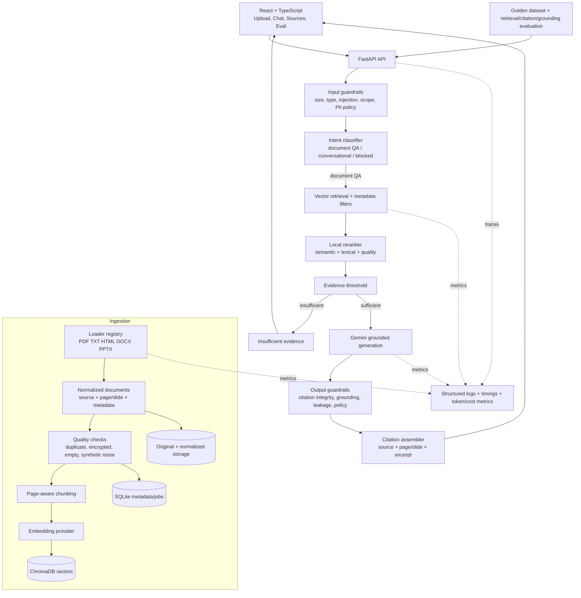

# Architecture

## Selected design

The reference image is adapted to React, FastAPI, Gemini, ChromaDB, and SQLite. Streamlit, Groq, and LangGraph are not required for the first implementation. A deterministic service pipeline is easier to test and observe; a graph orchestrator can be introduced later if branching workflows become genuinely complex.



## Processing by format

| Format | Loader | Location metadata | Important failure cases |
|---|---|---|---|
| PDF | `pypdf` | page number | encrypted, scanned/no text, malformed pages |
| TXT | encoding-aware reader | line range | binary data, unknown encoding, generated noise |
| HTML | Beautiful Soup | heading/section | scripts/styles, boilerplate, duplicate pages |
| DOCX | `python-docx` | paragraph/table index | corrupt package, text in unsupported objects |
| PPTX | `python-pptx` | slide number | image-only slides, notes and diagram text |

Every loader returns the same normalized segment contract:

```json
{
  "document_id": "doc_...",
  "source_name": "example.pdf",
  "media_type": "application/pdf",
  "location_type": "page",
  "location": 7,
  "heading": "Optional section heading",
  "text": "Extracted text",
  "content_hash": "sha256...",
  "quality_flags": []
}
```

## Retrieval and reranking

1. Embed the sanitized question using the same versioned embedding model as the collection.
2. Retrieve a broad candidate set (`top_k=12`) from Chroma.
3. Remove ineligible documents and exact duplicate chunks.
4. Rerank using a provider interface. The local baseline combines vector similarity, lexical overlap/BM25-style score, title match, and quality penalties. A cross-encoder can later implement the same interface.
5. Keep the best five candidates and apply an evidence threshold.
6. If evidence is insufficient, do not call Gemini.

## Guardrails

### Input

- File magic/type, extension, size, parser time, and archive-expansion limits.
- Filename/path isolation and SHA-256 duplicate detection.
- Question length and empty-input validation.
- Obvious prompt-injection and system-prompt-exfiltration patterns are flagged or blocked.
- Document text is always treated as untrusted evidence, never as executable instruction.
- Optional PII classification/redaction policy is a configuration boundary, not silently enabled.

### Output

- Only citation IDs supplied with retrieved evidence are accepted.
- Each citation resolves to a stored chunk in the current request.
- Answers with unsupported citations fail closed to an abstention/retry path.
- Secrets, system prompts, and excessive source reproduction are blocked.
- The API returns a structured `answered`, `insufficient_evidence`, or `blocked` status.

## Storage layers

- Original files: local `data/originals` for the exercise; object storage in production.
- Normalized JSON: local `data/normalized`, useful for inspection and reproducible reindexing.
- SQLite: document identity, ingestion jobs, quality flags, model/index versions, audit-safe events.
- ChromaDB: chunks, embeddings, and filterable source/location metadata.

## Evaluation

- Ingestion: extraction success, empty-segment rate, duplicates, parser failures.
- Retrieval: Recall@k, MRR/nDCG, source/page hit rate.
- Reranking: improvement in MRR/nDCG over vector-only retrieval.
- Generation: answer relevance, faithfulness, abstention precision/recall.
- Citations: citation precision, citation completeness, exact source/location integrity.
- Guardrails: blocked attack set, false-positive rate, sensitive-output tests.

